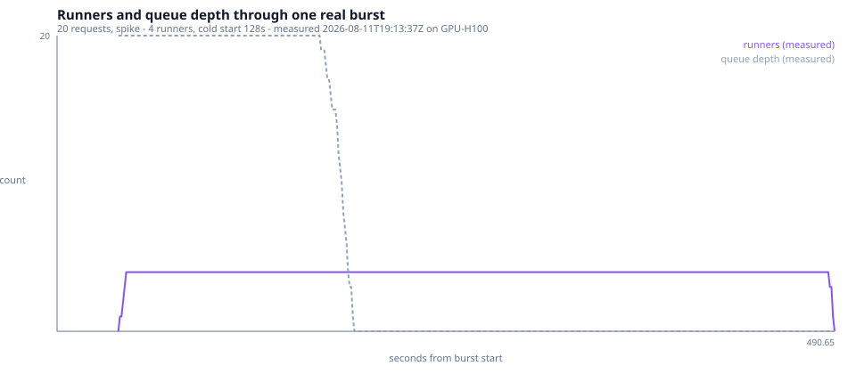
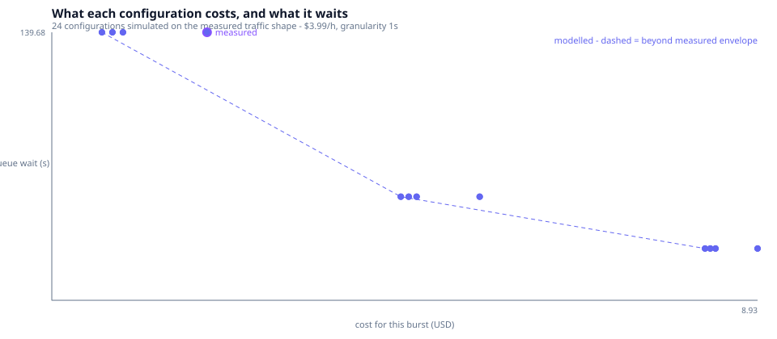

# Tune autoscaling for bursty traffic

Your endpoint is fine at steady traffic and falls over on launch day. fal gives you seven knobs to fix that — `keep_alive`, `min_concurrency`, `concurrency_buffer`, `concurrency_buffer_perc`, `max_concurrency`, `scaling_delay`, `max_multiplexing` — and the docs tell you what each one *means*. They don't tell you which values to pick, what the wrong pick costs, or how to find out for your own app. This example measures one real burst, then models the configurations that would be too expensive to measure.

> Catalog slot `02.2` ([SERV-1294](https://linear.app/features-and-labels/issue/SERV-1294)).

## What you get

A FLUX.2 [klein] endpoint that tells you who served every request, so a burst against it is self-measuring:

```json
{
  "image": { "url": "https://v3.fal.media/files/b/.../output.png" },
  "seed": 1234567890,
  "served_by": "2e138d5ee35d",
  "was_cold": true,
  "setup_duration_s": 127.566
}
```



Those last three fields are the whole trick. Distinct `served_by` values across one burst give you the runner ramp; `was_cold` marks who paid a cold start; `setup_duration_s` **is** the cold start, timed on the runner rather than guessed from a stopwatch on your laptop. No metrics API, no admin credential.

The recorded run in [`trace.json`](trace.json): **20 requests**, fired all at once, served by **4 runners**, cold start **127.6 s** (p50), service **3.0 s**.

## Run it

```bash
pip install -r requirements.txt   # fal==1.78.2 and the model deps
fal auth login
fal run app.py                    # local iteration against a real H100
```

## How it works

`setup()` times itself and mints a per-worker id; the endpoint reports both, plus whether it was that worker's first request. Everything else is measurement and arithmetic in three stdlib-only files — no plotting library, no numpy, because [`requirements.txt`](requirements.txt) has to mirror `App.requirements` exactly and anything listed there ships to the GPU.

```
fal deploy app.py --reset-scale
python burst.py  --app <your-username>/tune-autoscaling --pattern spike --requests 20   → trace.json
python model.py  --calibrate trace.json                                                 → frontier.json
```

### The seven knobs, as a decision

| knob | costs you | buys you | reach for it when | shown in |
|---|---|---|---|---|
| `keep_alive` | idle GPU seconds after every request | no cold start on the next one | your bursts cluster closer together than one cold start | the timeline |
| `min_concurrency` | a billed floor, traffic or not | zero cold start, ever | you have a p95 you cannot miss | the frontier |
| `concurrency_buffer` | N idle runners while you're busy | absorbs the ramp | the burst's slope outpaces runner start time | the frontier |
| `concurrency_buffer_perc` | idle runners in proportion to load | a buffer that scales with you | traffic varies by orders of magnitude | the frontier |
| `max_concurrency` | queue wait once you hit it | a hard spend ceiling | you'd rather queue than get a surprise bill | the frontier |
| `scaling_delay` | queue wait on every *real* burst | ignoring one-off spikes | brief spikes are noise, not demand | the timeline |
| `max_multiplexing` | contention inside one runner | more throughput per GPU-second | the work is I/O-bound — **not** diffusion, where it should stay 1 | the frontier |

### What you're actually billed for

This is the part most people get backwards. You pay for **the total time a runner is alive**, per second — not per request:

| Runner state | Billed |
|---|---|
| `PENDING` (waiting for capacity) | no |
| `DOCKER_PULL` | no |
| `SETUP` (your `setup()`) | **yes** |
| `IDLE` (including all of `keep_alive`) | **yes** |
| `RUNNING` | **yes** |
| `DRAINING`, `TERMINATING` | **yes** |

So queueing for capacity and pulling a fat image are free, while `keep_alive` idle time is not. 5xx responses aren't charged either. That table is the entire cost model — [`model.py`](model.py) integrates over it.

### Your scale settings may not be what your code says

`keep_alive`, `min_concurrency`, `max_concurrency`, both buffers, `scaling_delay` and `request_timeout` are **inherited across deploys**. A plain `fal deploy` keeps whatever is already live and ignores those values in your code — `fal deploy` defaults to `--no-scale`. Only `max_multiplexing`, `startup_timeout` and `machine_types` come from code every time.

```bash
fal deploy app.py --reset-scale     # actually apply the code's knobs
fal apps scale tune-autoscaling --keep-alive 30   # or change them at runtime
```

This is why [`burst.py`](burst.py) records the config from `fal apps list --json` rather than trusting `app.py`: a trace stamped with knobs that weren't running is worse than no trace.

### What the model does, and what it doesn't know

[`model.py`](model.py) simulates the same traffic under configurations we didn't pay to measure. Three honest caveats:

- **fal publishes no scaling formula.** The law the model uses — `runners = clamp(ceil(ongoing / max_multiplexing) + buffer, min, max)` — was reconstructed from the three diagrams on [the scaling reference](https://docs.fal.ai/documentation/deployment/scale-your-application), and [`test_app.py`](test_app.py) checks it against every labelled bar in all three (`PUBLISHED_CHARTS`). That's strong, not authoritative.
- **Scale-*down* dynamics are published nowhere.** So they are *measured* here rather than modelled, and the measured timeline is the authority whenever it disagrees with the model.
- **Billing granularity is published nowhere.** The model rounds each runner's alive time up to 1 s (`--billing-granularity`). It matters most at short `keep_alive`.

## Deploy

```bash
fal deploy app.py --reset-scale      # -> <your-username>/tune-autoscaling
```

```bash
curl -X POST https://fal.run/<your-username>/tune-autoscaling \
  -H "Authorization: Key $FAL_KEY" -H "Content-Type: application/json" \
  -d '{"prompt": "a calico cat riding a bicycle through a sunlit wheat field"}'
```

## Cost & tuning



Same 20-request spike, four configurations, priced over a **1-hour horizon** at the published H100 list rate of $3.99/h ($0.001108/s) — if you're on a negotiated rate, pass `--rate`. Only the first row was measured; the rest are model output. This is deliberately a hard rate, not the price of one burst: a `min_concurrency` runner is alive around the clock, so the model bills it for the whole horizon whether or not the burst ever lands (`--bursts-per-hour 1 --horizon-s 3600`, both defaults).

| `keep_alive` / `min` / `buffer` | cost/h | p50 wait | p95 wait | peak runners | |
|---|---|---|---|---|---|
| 300 / 0 / 0 | $1.96 | 133.7 s | 139.7 s | 4 | **measured** |
| 0 / 0 / 0 | $0.63 | 133.7 s | 139.7 s | 4 | modelled |
| 300 / 2 / 0 | $8.93 | 12.1 s | 27.0 s | 4 | modelled |
| 300 / 0 / 1 | $1.96 | 133.6 s | 139.7 s | 4 | modelled |

Read the first two rows together: the recorded config's `keep_alive=300` buys **identical** latency to `keep_alive=0` — same 133.7 s p50, same 139.7 s p95 — for three times the cost. That's not a rounding artifact. `keep_alive` only pays for itself when a *second* burst lands inside the window it holds open, and this trace is a one-off spike deep inside a one-hour horizon: nothing arrives to reuse the warm runner, so the 300 s tail is pure spend. The modelled sweep agrees completely — of the 24 configurations checked (all `validated`, meaning none needed more than the 4 runners this burst actually produced), the 5 that make the Pareto front **all have `keep_alive=0`**. For a burst shaped like this one, `keep_alive` is not a lever, it's a tax.

The knob that does move latency is `min_concurrency`, at `keep_alive=0`:

| `min_concurrency` | cost/h | p95 wait |
|---|---|---|
| 0 | $0.63 | 139.7 s |
| 1 | $4.42 | 54.0 s |
| 2 | $8.26 | 27.0 s |

Each step removes one runner's worth of cold start from the queue and roughly triples the bill, because that runner is now billed for the full hour instead of zero. There is no free option here — every millisecond of p95 you buy back is a 24/7 floor, not a per-burst charge.

- **Your bursts are rare relative to `keep_alive`** (this trace): set `keep_alive=0`. Paying for the idle tail bought nothing measurable.
- **Your bursts cluster tighter than one cold start apart:** raise `keep_alive` past the gap between them — not the case in this trace, but that's the mechanism it's for.
- **You have a hard p95 you can't miss:** `min_concurrency ≥ 1` is the only knob this data shows actually cutting latency, and you're budgeting it 24/7, not per burst.
- **Always set `max_concurrency`.** It's your only spend ceiling — this deploy's is 4, exactly the peak every configuration above needed.

Re-run the whole analysis against your own traffic:

```bash
python burst.py --app <your-username>/your-app --pattern ramp --requests 60 --duration 30
python model.py --calibrate trace.json --rate 0.000525   # your rate
```

## Next steps

- **02.1 — cut cold starts:** the 127.6 s this example treats as fixed is 02.1's whole subject.
- **08.5 — track usage & cost per app:** the same dollars, observed after the fact from the platform APIs.
- Concept docs: [scaling parameter reference](https://docs.fal.ai/documentation/deployment/scale-your-application) · [cold start & scaling](https://docs.fal.ai/documentation/serverless/optimizations/cold-start-scaling) · [serverless pricing](https://docs.fal.ai/documentation/serverless/pricing)
